# 逻辑 schema（ai_platform）

> v0.7 · 单租户 · 面向本地开发与单机服务器
> 物理 DDL：新库用 `deploy/sql/02-schema.sql`；已有库依次执行一次 `04-schema-v2.sql`、`05-rbac.sql`、`06-fix-comments.sql`、`07-platform-nav.sql`、`08-enable-status-tinyint.sql`、`09-sys-app-and-knowledge-app.sql`，再执行 `03-seed-data.sql`。
> 不引入多租户与迁移工具；表结构变更仍走“手工 DDL + 增量脚本 + 同步文档”。

## 服务与表归属

| 表 | 所属微服务 | 说明 |
|----|------------|------|
| `sys_user` | ai-auth | 用户、BCrypt 密码、状态 |
| `sys_role` | ai-auth | 角色（ADMIN / USER） |
| `sys_permission` | ai-auth | 权限码 |
| `sys_menu` | ai-auth | 菜单/导航 |
| `sys_user_role` | ai-auth | 用户-角色 |
| `sys_role_permission` | ai-auth | 角色-权限 |
| `sys_role_menu` | ai-auth | 角色-菜单 |
| `sys_app` | ai-auth | 平台 AI 应用注册（`code` 与路由 `/apps/:appId` 一致） |
| `chat_session` | ai-service-conversation | 对话会话 |
| `chat_message` | ai-service-conversation | 对话消息与模型调用元数据 |
| `knowledge_document` | ai-service-knowledge | 知识库文档元数据 |
| `knowledge_chunk` | ai-service-knowledge | 文档分块与向量 ID |

当前 **共用库** `ai_platform`；`owner_user_id` 都是**逻辑关联** `sys_user.id`，无跨服务外键。
`knowledge_chunk → knowledge_document` 同服务内使用 FK。

## ER

```mermaid
erDiagram
    sys_user ||--o{ chat_session : "owner_user_id"
    chat_session ||--o{ chat_message : "session_id FK"
    sys_user ||--o{ knowledge_document : "owner_user_id"
    knowledge_document ||--o{ knowledge_chunk : "document_id FK"
    sys_user ||--o{ sys_user_role : "user_id"
    sys_role ||--o{ sys_user_role : "role_id"
    sys_role ||--o{ sys_role_permission : "role_id"
    sys_permission ||--o{ sys_role_permission : "permission_id"
    sys_role ||--o{ sys_role_menu : "role_id"
    sys_menu ||--o{ sys_role_menu : "menu_id"

    sys_user {
        bigint id PK
        varchar username UK
        varchar password_hash
        json roles
        json permissions
        varchar status
        datetime last_login_at
        datetime created_at
        datetime updated_at
    }

    sys_role {
        bigint id PK
        varchar code UK
        varchar name
        varchar status
    }

    sys_permission {
        bigint id PK
        varchar code UK
        varchar name
    }

    sys_menu {
        bigint id PK
        bigint parent_id
        varchar name
        varchar path
        varchar permission_code
    }

    chat_session {
        char id PK
        bigint owner_user_id
        varchar title
        int message_count
        datetime last_message_at
        datetime created_at
        datetime updated_at
    }

    chat_message {
        bigint id PK
        char session_id FK
        varchar client_message_id
        varchar role
        mediumtext content
        varchar status
        varchar provider
        varchar model
        int prompt_tokens
        int completion_tokens
        int latency_ms
        varchar trace_id
        json metadata
        datetime created_at
    }

    knowledge_document {
        char id PK
        bigint owner_user_id
        varchar file_name
        char content_hash
        int chunk_count
        varchar status
        datetime created_at
        datetime deleted_at
    }

    knowledge_chunk {
        bigint id PK
        char document_id FK
        int chunk_index
        mediumtext content
        varchar vector_id
    }
```

## 编码与时间

- 表统一 `utf8mb4` / `utf8mb4_unicode_ci`；SQL 文件 UTF-8。
- 初始化/执行 SQL 必须带 `--default-character-set=utf8mb4`，否则中文注释会被按 GBK 解释。
- 时间统一 `DATETIME(6)`，语义 **Asia/Shanghai**，由应用写入；`updated_at` 同时有数据库默认值兜底。

## sys_user

| 列 | 类型 | 说明 |
|----|------|------|
| id | BIGINT PK AI | 与 Sa-Token `loginId` 数值一致 |
| username | VARCHAR(64) UK | 登录名 |
| password_hash | VARCHAR(128) | BCrypt |
| roles | JSON | 角色列表 |
| permissions | JSON | 权限码，见 `AiPermissions` |
| status | TINYINT | 启用状态：`0`=禁用，`1`=启用；默认 `1` |
| last_login_at | DATETIME(6) | 最近登录时间，可空 |
| created_at | DATETIME(6) | 创建时间 |
| updated_at | DATETIME(6) | 最后更新时间，DB 默认 + 应用填充 |

索引：`uk_sys_user_username`、`idx_sys_user_status`。

**权限模型：** 登录优先读 `sys_user_role → sys_role → sys_role_permission → sys_permission`；关系表为空或不可用时回退 `roles/permissions` JSON。详见 [access-control.md](../standards/access-control.md)。

## sys_role

| 列 | 类型 | 说明 |
|----|------|------|
| id | BIGINT PK AI | 角色主键 |
| code | VARCHAR(64) UK | `ADMIN` / `USER` |
| name | VARCHAR(64) | 角色名称 |
| description | VARCHAR(255) | 说明 |
| status | TINYINT | 启用状态：`0`=禁用，`1`=启用 |
| sort_order | INT | 排序 |
| created_at / updated_at | DATETIME(6) | 时间 |

## sys_permission

| 列 | 类型 | 说明 |
|----|------|------|
| id | BIGINT PK AI | 权限主键 |
| code | VARCHAR(128) UK | 如 `ai:knowledge:write` |
| name | VARCHAR(64) | 权限名称 |
| group_name | VARCHAR(64) | 分组/模块 |
| description | VARCHAR(255) | 说明 |
| created_at / updated_at | DATETIME(6) | 时间 |

## sys_menu

| 列 | 类型 | 说明 |
|----|------|------|
| id | BIGINT PK AI | 菜单主键 |
| parent_id | BIGINT | 父菜单，0 为根 |
| name | VARCHAR(64) | 菜单名称 |
| path | VARCHAR(128) UK | 前端路由 |
| icon | VARCHAR(64) | 图标 |
| permission_code | VARCHAR(128) | 进入菜单所需权限，可空 |
| sort_order | INT | 排序 |
| visible | TINYINT(1) | 是否可见 |
| status | TINYINT | 启用状态：`0`=禁用，`1`=启用 |
| created_at / updated_at | DATETIME(6) | 时间 |

## 关联表

| 表 | 主键 | 说明 |
|----|------|------|
| `sys_user_role` | `(user_id, role_id)` | 用户-角色 |
| `sys_role_permission` | `(role_id, permission_id)` | 角色-权限 |
| `sys_role_menu` | `(role_id, menu_id)` | 角色-菜单 |

关联表都有双向 FK + CASCADE；删除角色会清掉授权关系。

## chat_session

| 列 | 类型 | 说明 |
|----|------|------|
| id | CHAR(36) PK | UUID |
| owner_user_id | BIGINT | `sys_user.id` |
| title | VARCHAR(128) | 会话标题，默认 `新对话`；首条用户消息自动生成 |
| message_count | INT | 消息条数（冗余字段，便于列表） |
| last_message_at | DATETIME(6) | 最后一条消息时间 |
| created_at | DATETIME(6) | 创建时间 |
| updated_at | DATETIME(6) | 最后更新时间 |

索引：`idx_chat_session_owner_updated (owner_user_id, updated_at DESC)`。

## chat_message

| 列 | 类型 | 说明 |
|----|------|------|
| id | BIGINT PK AI | 稳定排序次级键 |
| session_id | CHAR(36) FK | → `chat_session.id`，ON DELETE CASCADE |
| client_message_id | VARCHAR(64) | 客户端消息 ID，用于重试幂等；可空 |
| role | VARCHAR(16) | `user` / `assistant` |
| content | MEDIUMTEXT | 正文；API 单条上限 4000 字符 |
| status | VARCHAR(16) | `PENDING/STREAMING/COMPLETED/FAILED`，默认 `COMPLETED` |
| provider | VARCHAR(32) | 模型提供方，如 `deepseek` |
| model | VARCHAR(64) | 实际模型名 |
| prompt_tokens / completion_tokens | INT | token 用量 |
| latency_ms | INT | 模型调用耗时 |
| finish_reason | VARCHAR(32) | 模型结束原因 |
| trace_id | VARCHAR(64) | 链路追踪 ID |
| metadata | JSON | 引用/扩展元数据（如 sources） |
| created_at | DATETIME(6) | 创建时间 |

索引：
- `uk_chat_message_client (session_id, client_message_id)` — 幂等；NULL 可重复。
- `idx_chat_message_session_created_id (session_id, created_at, id)` — 历史查询/稳定排序。
- `idx_chat_message_trace (trace_id)` — 排查。

**排序约定：** `ORDER BY created_at ASC, id ASC`（或倒序取最近 N 条再反转）。

> `provider/model/prompt_tokens/completion_tokens/latency_ms/finish_reason/trace_id` 已随对话写入；`metadata` 仍预留。

## sys_app

| 列 | 类型 | 说明 |
|----|------|------|
| id | BIGINT PK AI | 主键 |
| code | VARCHAR(32) UK | 应用标识，如 `health` |
| name | VARCHAR(64) | 名称 |
| tagline | VARCHAR(128) | 副标题 |
| description | VARCHAR(512) | 说明 |
| expert_id | VARCHAR(64) | 对话专家 ID（LLM 配置） |
| status | TINYINT | 0=禁用，1=启用 |
| sort_order | INT | 列表排序 |
| created_at / updated_at | DATETIME(6) | 时间 |

索引：`uk_sys_app_code`、`idx_sys_app_status_sort`。

## knowledge_document

| 列 | 类型 | 说明 |
|----|------|------|
| id | CHAR(36) PK | 文档 UUID |
| owner_user_id | BIGINT | 上传用户 |
| app_id | VARCHAR(32) | 所属应用 → `sys_app.code`（逻辑关联） |
| category | TINYINT | 资料类型，见 `knowledge_doc_category` |
| file_name | VARCHAR(255) | 原始文件名 |
| storage_path | VARCHAR(512) | 本地存储路径 |
| content_hash | CHAR(64) | SHA-256，用于去重/校验 |
| size_bytes | BIGINT | 文件大小 |
| chunk_count | INT | 分块数 |
| embedding_model | VARCHAR(64) | 生成向量所用模型 |
| status | VARCHAR(16) | `UPLOADING/INDEXED/FAILED` |
| error_message | VARCHAR(512) | 失败原因 |
| created_at / updated_at | DATETIME(6) | 时间 |
| deleted_at | DATETIME(6) | 软删除时间，可空 |

索引：`idx_knowledge_document_owner_created`、`idx_knowledge_document_app_created`、`idx_knowledge_document_app_category`、`idx_knowledge_document_hash`。

同一 `content_hash` 可在不同 `app_id` 下重复入库（按应用去重）。

## knowledge_chunk

| 列 | 类型 | 说明 |
|----|------|------|
| id | BIGINT PK AI | 分块主键 |
| document_id | CHAR(36) FK | → `knowledge_document.id`，ON DELETE CASCADE |
| chunk_index | INT | 从 0 开始 |
| content | MEDIUMTEXT | 分块正文 |
| token_count | INT | token 数 |
| vector_id | VARCHAR(128) | 向量库 ID |
| created_at | DATETIME(6) | 创建时间 |

索引：`uk_knowledge_chunk_doc_index (document_id, chunk_index)`、`idx_knowledge_chunk_document`。

> v0.7 已接入：上传写 `knowledge_document` + `knowledge_chunk`，启动时从分块重建内存向量索引；`deleted_at` 为后续软删预留。

## 演示账号

| username | password | 说明 |
|----------|----------|------|
| admin | admin123 | 全部权限（AI + 系统管理） |
| user | user123 | chat + knowledge:read |

种子：`deploy/sql/03-seed-data.sql` 同时写入用户、角色、权限、菜单与关联（幂等）；`AuthUserSeeder` 只保证演示用户存在。生产环境应禁用默认账号。

