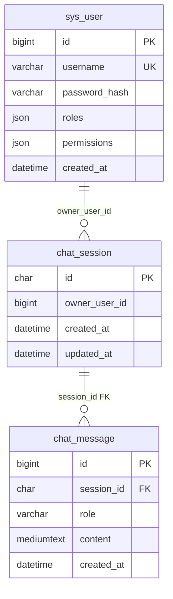

# 逻辑 schema（ai_platform）

与环境无关的表设计说明。物理 DDL 以 `deploy/sql/02-schema.sql` 为准。

## 服务与表归属

| 表 | 所属微服务 | 说明 |
|----|------------|------|
| `sys_user` | ai-auth | 用户与 BCrypt 密码 |
| `chat_session` | ai-service-conversation | 对话会话 |
| `chat_message` | ai-service-conversation | 对话消息 |

当前 **共用库** `ai_platform`；`chat_session.owner_user_id` **逻辑关联** `sys_user.id`，**无跨服务外键**。

## ER

## sys_user

| 列 | 类型 | 说明 |
|----|------|------|
| id | BIGINT PK AI | 与 Sa-Token `loginId` 数值一致 |
| username | VARCHAR(64) UK | 登录名 |
| password_hash | VARCHAR(128) | BCrypt |
| roles | JSON | 角色列表，简单 RBAC |
| permissions | JSON | 权限码，见 `AiPermissions` |
| created_at | DATETIME(6) | Asia/Shanghai，应用自动填充 |

**权限模型（当前阶段）：** JSON 存 roles/permissions，登录时写入 Redis Session；不做独立角色表。若后续需要权限后台与反查，再按 [database-design.md](../standards/database-design.md) 演进。

种子：`deploy/sql/03-seed-data.sql`（可与 `AuthUserSeeder` 互补）。

## chat_session

| 列 | 类型 | 说明 |
|----|------|------|
| id | CHAR(36) PK | UUID |
| owner_user_id | BIGINT | `sys_user.id` |
| created_at | DATETIME(6) | Asia/Shanghai |
| updated_at | DATETIME(6) | Asia/Shanghai，append 消息时 update 触发填充 |

索引：`idx_chat_session_owner_updated (owner_user_id, updated_at DESC)` — 按用户查最近会话。

## chat_message

| 列 | 类型 | 说明 |
|----|------|------|
| id | BIGINT PK AI | 稳定排序次级键 |
| session_id | CHAR(36) FK | → `chat_session.id`，ON DELETE CASCADE |
| role | VARCHAR(16) | `user` / `assistant` |
| content | MEDIUMTEXT | 正文；API 单条上限 16KB |
| created_at | DATETIME(6) | Asia/Shanghai |

索引：`idx_chat_message_session_created_id (session_id, created_at, id)`。

**排序约定：** 查询使用 `ORDER BY created_at ASC, id ASC`（或先 DESC 取最近 N 条再反转），避免相同时间戳顺序不稳定。

## 演示账号

| username | password | 说明 |
|----------|----------|------|
| admin | admin123 | 全部 AI 权限 |
| user | user123 | chat + knowledge:read |

种子：`deploy/sql/03-seed-data.sql` 与 `AuthUserSeeder` 幂等一致。
